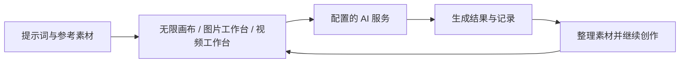

<p align="center"></p>

# 四季画布 FourJ Canvas

**把参考素材、提示词、AI 生成与创作记录放在同一个桌面工作区。**

四季画布是本地优先的 AI 视觉创作桌面应用。你可以在无限画布上连接文字与参考图，也可以直接进入图片或视频工作台，生成结果后继续整理、对比与复用。

[下载稳定版](https://github.com/deepfry666/fourj-canvas/releases/tag/v0.1.10) · [查看测试版](https://github.com/deepfry666/fourj-canvas/releases/tag/v0.1.11-beta.4) · [安装与首次创作](docs/content/docs/overview/quick-start.zh-CN.mdx) · [功能介绍](docs/content/docs/overview/features.zh-CN.mdx)

基于 [basketikun/infinite-canvas](https://github.com/basketikun/infinite-canvas) 独立维护，不代表上游官方版本。源码采用 [MIT](LICENSE)，第三方资源遵守[各自声明](THIRD_PARTY_NOTICES.md)。

## 可以做什么

- **组织创意**：用图片、文本和生成配置节点搭建画布，通过连线组织输入，支持缩放、框选、撤销与重做。
- **生成图片与视频**：从提示词和参考素材开始，在独立工作台或画布中创作；可用能力取决于配置的服务商和模型。
- **用对话辅助创作**：选择自己的文字模型，润色提示词、理解选中节点、预览并确认画布操作，无需额外安装 Codex 或 MCP。
- **复用素材与提示词**：整理“我的素材”、浏览提示词库，把已有内容带回画布。
- **回看创作过程**：查看生成记录与创作统计；本机工作区保存画布、素材和记录，可选 WebDAV 跨设备同步。

下面是**创作流程示意，不是软件截图或生成效果展示**：



## 下载与快速开始

当前公开安装包面向 **Windows x64**：

| 版本 | 适合谁 | 下载 |
| --- | --- | --- |
| 稳定版 v0.1.10 | 优先使用正式发布版本 | [Release 与安装包](https://github.com/deepfry666/fourj-canvas/releases/tag/v0.1.10) |
| 测试版 v0.1.11-beta.4 | 体验创作 Skill 等新能力，并接受测试版风险 | [Release 与安装包](https://github.com/deepfry666/fourj-canvas/releases/tag/v0.1.11-beta.4) |

1. 在对应 Release 的 Assets 中下载 `FourJCanvas-…-x64.exe`，按该版本说明核对 SHA-256 后安装。安装包尚未进行 Windows 代码签名；遇到系统警告时先确认来源，不要盲目放行。
2. 打开「设置」，配置自己的 AI 服务地址、API Key 和模型，并确认本地工作区位置。
3. 进入图片工作台，输入提示词，确认模型与数量后开始；或创建画布，将参考图与文字组织成工作流。

安装版无需 Node.js、Docker 或外部 Agent 服务。模型调用费用由对应服务商收取，不包含免费模型额度。详细校验、首次配置与常见问题见[快速开始](docs/content/docs/overview/quick-start.zh-CN.mdx)。

稳定版与测试版有独立更新通道；稳定版通道不会自动安装预发布版本。源码虽包含 macOS 构建入口，**目前没有正式公开的 Mac 安装版**。本项目是 Electron 桌面产品，`web/` 只是桌面渲染层，不是独立网页端。

## 数据、费用与安全

- **本地优先不等于离线 AI**：API Key 保存在桌面应用的本地配置中；Electron 渲染层直接请求你配置的 AI 接口，提示词与所用参考素材会发给相应服务。请先了解服务商的价格和数据政策。
- 画布、素材和生成记录以本机工作区为权威存储；可选 WebDAV 用于同步，不能替代独立备份。远程结果地址可能过期，重要作品请确认已保存到本地。
- 不要分享含 API Key、WebDAV 凭据或私人内容的配置导出、日志及截图。远程节点插件可访问页面数据，包括本地 API Key，只安装可信来源的插件。参见[安全说明](SECURITY.md)。

## 本地开发

使用 Node.js 24 LTS（验证版本见 [.node-version](.node-version)）；原有测试依赖 Node 24 的 TypeScript 转换参数，不支持 Node 26。若使用 fnm，可先运行 `fnm use --install-if-missing`。

```bash
git clone https://github.com/deepfry666/fourj-canvas.git FourJ-Canvas
cd FourJ-Canvas
npm ci
npm --prefix web ci --legacy-peer-deps
npm run desktop:dev
```

常用检查：`npm test`、`npm run web:typecheck`、`npm run web:build`。打包与平台边界见[桌面开发说明](desktop/README.md)。

## 文档导航

- 使用：[功能介绍](docs/content/docs/overview/features.zh-CN.mdx) · [画布节点](docs/content/docs/canvas/canvas-node-manual.zh-CN.mdx) · [快捷键](docs/content/docs/canvas/canvas-shortcuts.zh-CN.mdx)
- 版本：[全部发行版本](https://github.com/deepfry666/fourj-canvas/releases) · [更新记录](CHANGELOG.md) · [待实机验证事项](docs/content/docs/progress/pending-test.zh-CN.mdx)
- 源码：[公开范围与开发机迁移](OPEN_SOURCE.md) · [源码基线](SOURCE_SNAPSHOT.json) · [源码验证说明](SOURCE_VERIFICATION.md)
- 许可：[上游来源](NOTICE.md) · [MIT](LICENSE) · [第三方声明](THIRD_PARTY_NOTICES.md)

公开源码快照基于 `v0.1.11-beta.4`；历史标签和安装包保持不变，不代表已验证旧包的可复现构建。MiSans 字体文件未分发，系统未安装时使用原有字体回退；Noto Serif SC 和 PT Serif 附带 SIL OFL 许可。
